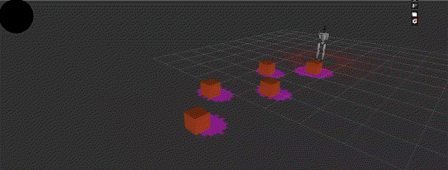
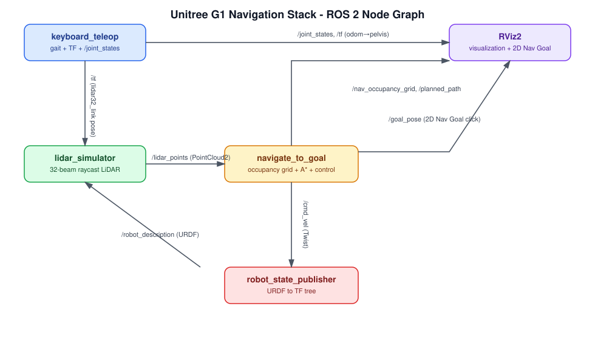
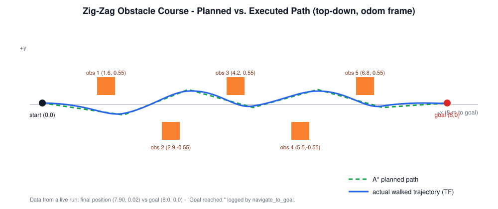

# Unitree G1 Humanoid — ROS 2 Navigation & Gait Simulation



A ROS 2 Humble simulation of a **Unitree G1 23-DOF humanoid** that walks with a
biomechanically-tuned gait, senses its surroundings with a simulated 32-beam
LiDAR, and autonomously **navigates to a goal point while avoiding obstacles**
— all visualized live in RViz2, no physics engine required.

Give it a goal in RViz ("2D Nav Goal") and the robot plans a path through an
occupancy grid built from LiDAR data, simplifies it, and walks itself there,
re-planning on the fly as it discovers obstacles.

[▶ Full video](humanoid.mp4) · node/topic graph below



## Highlights

- **23-DOF humanoid gait** — keyframe-based walking cycle derived from real
  clinical gait-analysis data (double-hump knee flexion, asymmetric hip
  swing, ankle push-off), not a simple sinusoid. Correct joint sign
  conventions and rest poses were verified with forward kinematics rather
  than assumed.
- **Simulated 32-beam mechanical LiDAR** — ray/box and ray/ground
  intersection in Python, published as a real `sensor_msgs/PointCloud2`,
  visualized as a spinning point cloud in RViz.
- **Autonomous navigation** — LiDAR points are rasterized into an
  `nav_msgs/OccupancyGrid`, inflated by the robot's radius, searched with
  8-connected A*, and simplified via line-of-sight pruning. A proportional
  heading controller then drives the walking gait (via `/cmd_vel`) along the
  resulting waypoints, turning in place for sharp turns and re-planning
  periodically.
- **Keyboard teleop fallback** — drive the robot manually at any time;
  manual input always takes priority back from the navigation node.

## How it works

```
2D Nav Goal (RViz) ──▶ /goal_pose
                              │
LiDAR scan ──▶ /lidar_points  │
      │                       ▼
      │              navigate_to_goal
      │        (occupancy grid → A* → path
      │         simplify → waypoint control)
      │                       │
      └───────────────▶ /cmd_vel (Twist)
                              │
                              ▼
                      keyboard_teleop
                 (walking gait keyframes,
                  publishes /joint_states, /tf)
                              │
                              ▼
                   robot_state_publisher ──▶ RViz2
```

See [docs/images/architecture.svg](docs/images/architecture.svg) for the full
node/topic graph.

## Obstacle avoidance in action

A 5-box zig-zag "slalom" course is placed down the walking path so a
straight-line path is guaranteed to collide — proving the planner actually
has to weave, not just walk forward. The diagram below overlays the real A*
plan against a live-recorded TF trajectory from an actual test run (goal at
`(8.0, 0.0)`, 5 obstacles alternating ±0.55 m):



The executed path tracks the plan closely and the robot reaches the goal —
`navigate_to_goal` logs `"Goal reached."` once the final waypoint is consumed.

## Package layout

```
src/
├── g1_description/          # Unitree G1 URDF, meshes, visual/collision geometry
└── humanoid_robot/
    ├── humanoid_robot/
    │   ├── keyboard_teleop.py     # gait engine, TF + /joint_states, /cmd_vel sink
    │   ├── lidar_simulator.py     # 32-beam LiDAR raycasting + obstacle course
    │   └── navigate_to_goal.py    # occupancy grid, A*, path simplify, controller
    ├── launch/display.launch.py   # robot_state_publisher + RViz2 + LiDAR + nav
    └── rviz/humanoid.rviz         # pre-configured RViz layout
```

## Requirements

- Ubuntu 22.04
- ROS 2 Humble
- `python3-numpy`, `sensor_msgs_py` (installed with a standard ROS 2 Humble desktop setup)

## Build

```bash
source /opt/ros/humble/setup.bash
cd human_ws
colcon build --symlink-install
source install/setup.bash
```

## Run

**Terminal 1** — launches `robot_state_publisher`, RViz2, the LiDAR
simulator, and the navigation node:

```bash
ros2 launch humanoid_robot display.launch.py
```

**Terminal 2** — keyboard teleop (needs a real TTY, so it runs separately):

```bash
ros2 run humanoid_robot keyboard_teleop
```

Then in RViz:

1. Click the **2D Nav Goal** tool in the toolbar.
2. Click a point past the obstacle course (e.g. anywhere near `x = 8`).
3. Watch the robot plan a path around the zig-zag obstacles and walk itself
   there. You can retake manual control at any time from the teleop terminal.

## Topics

| Topic | Type | Description |
|---|---|---|
| `/joint_states` | `sensor_msgs/JointState` | 23-DOF joint angles |
| `/tf` | `tf2_msgs/TFMessage` | `odom` → `pelvis` and the full URDF tree |
| `/lidar_points` | `sensor_msgs/PointCloud2` | Simulated 32-beam LiDAR scan |
| `/obstacle_markers` | `visualization_msgs/MarkerArray` | Obstacle course visualization |
| `/goal_pose` | `geometry_msgs/PoseStamped` | Navigation goal (RViz "2D Nav Goal") |
| `/nav_occupancy_grid` | `nav_msgs/OccupancyGrid` | Grid built from LiDAR, inflated by robot radius |
| `/planned_path` | `nav_msgs/Path` | Simplified A* path |
| `/cmd_vel` | `geometry_msgs/Twist` | Drives the walking gait (keyboard or navigation) |

## License

`g1_description` carries Unitree's own LICENSE. `humanoid_robot` is
Apache-2.0 — see [src/humanoid_robot/package.xml](src/humanoid_robot/package.xml).
